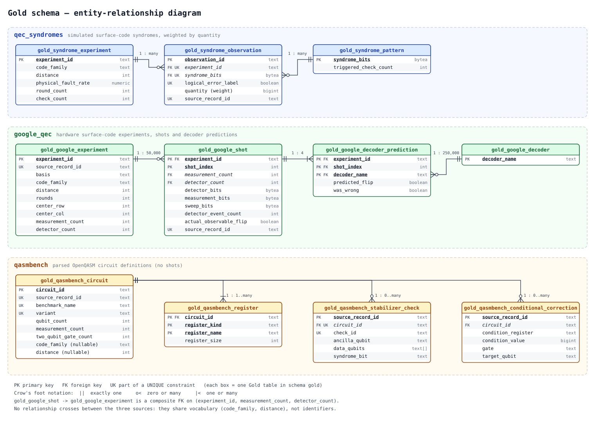

# Part I design report: QEC data pipeline

This is the single Part I design report requested in `assignment/brief.md`. It covers source discovery, the architecture, the Gold
design, the important decisions, the rejected relationship, quality findings,
the detector-storage measurement, the three analyses and the two example
traces. The answers to every "Questions to investigate" item in
`assignment/data-sources.md`, with their evidence, are in the decision log,
[decision-log.md](decision-log.md).

**Commands** (run from `starter/` inside the workspace container):

| Purpose | Command |
| --- | --- |
| Run all of Part I (Bronze → Silver → Gold → ML → trace) | `make run` |
| Run the tests | `make test` |
| Part II | `make train` |

**Contents**

1. [Architecture](#1-architecture)
2. [Source discovery](#2-source-discovery)
3. [Bronze: unchanged inputs](#3-bronze-unchanged-inputs)
4. [Silver: cleaning and quality rules](#4-silver-cleaning-and-quality-rules)
5. [Quality findings](#5-quality-findings)
6. [Gold: relational design](#6-gold-relational-design)
7. [Rejected relationship](#7-rejected-relationship)
8. [Gold-to-ML export](#8-gold-to-ml-export)
9. [Tracing and example traces](#9-tracing-and-example-traces)
10. [Analysis questions](#10-analysis-questions)
11. [Repeated runs and run evidence](#11-repeated-runs-and-run-evidence)
12. [Tests](#12-tests)
13. [Limitations](#13-limitations)

---

## 1. Architecture

We use the course architecture without deviations:

```text
bronze:  the three supplied archives, read-only
silver:  six source-specific Parquet tables 
gold:    our "designed PostgreSQL model"
ml:      two fixed Parquet tables for Part II 

results/part1  data_issues, run.json, row_counts.json, source_trace, trace_examples, analysis/
```

`make run` executes five stages in order with one shared `run_id` and stops
if any of the stages fail:

| Stage | Code | Reads | Writes |
| --- | --- | --- | --- |
| `register_sources` | [register_sources.py](../starter/src/quantum_lake_student/stages/register_sources.py) | Bronze archives + course manifest | `run.json`, `row_counts.json` |
| `prepare_data` | [prepare_data.py](../starter/src/quantum_lake_student/stages/prepare_data.py) | Bronze | six Silver tables, `source_trace.parquet`, `data_issues.parquet` |
| `load_postgres` | [load_postgres.py](../starter/src/quantum_lake_student/stages/load_postgres.py) | Silver | Gold tables, catalog view, ML views |
| `build_ml_tables` | [build_ml_tables.py](../starter/src/quantum_lake_student/stages/build_ml_tables.py) | Gold views only | two ML tables, three analysis results |
| `trace_examples` | [trace_examples.py](../starter/src/quantum_lake_student/stages/trace_examples.py) | ML, Gold, Silver, trace, Bronze | `trace_examples.json` |

Each layer reads only the one before it. The ML export never reads Bronze or
Silver, and a test checks this. A
full run takes about 30 seconds without running any notebook cells (The notebook was just used for the first discovery stage).

---

## 2. Source discovery

We recorded discovery questions and their evidence in
[decision-log.md](decision-log.md). The table below summarises
what we found for each source.

| | `qec_syndromes` | `google_qec` | `qasmbench` |
| --- | --- | --- | --- |
| **Files** | 7 CSVs `d-3_pfr-<rate>_nb-10M.csv` (8 archive members) | 5 experiment folders (4 × d=3, 1 × d=5), 15 companion files each (76 members) | 3 benchmarks × source/`_transpiled` `.qasm` (19 members, 6 circuits) |
| **Formats** | CSV with a Python-literal nested tuple column | YAML, Stim `b8` (packed bits), Stim `01` (one line per shot) | OpenQASM 2 |
| **One record is** | one aggregate row: a (syndrome, label) pair with a count | one shot = position *i* across 8 aligned companion files | one circuit file |
| **Candidate identifiers** | filename (experiment); file + row position (record) | folder name (experiment); folder + shot index (shot) | benchmark + variant |
| **Nested / packed values** | `syndromes` = 4 rounds × 4 checks as text | `measurements.b8`, `detection_events.b8`, `sweep.b8`, little-endian, byte-aligned per shot | custom gates, register-wide statements, `if(...)` blocks |
| **Weights / repeats** | `quantity` = number of physical observations; 70M in total | none: each shot appears once | none |
| **Relationships** | 1 file → many rows; the same syndrome appears under both labels | 1 experiment → 50,000 shots → 4 decoder predictions each | 1 circuit → its registers, parity checks and corrections |

Findings that shaped the design:

- **Syndromes:** the documented `label` header is actually `labels`. Every
  row is a valid 4×4 binary shape. The quantities in each file sum to
  exactly 10,000,000. **18,676 syndrome patterns occur with both labels**,
  so a syndrome alone is not a key and the two rows must not be deduplicated.
- **Google:** the real `properties.yml` keys are `circuit_measurements` and
  `circuit_detectors`. A d=3 shot has 209
  measurements and 200 detectors; a d=5 shot has 600 detectors. Measurements,
  detector events, the actual logical flip and the four decoder predictions
  are separate concepts stored in separate files.
- **QASMBench:** only `qec_sm_n5` has an explicit parity-check structure:
  3 data qubits, 2 ancillas and a 2-bit syndrome register. The other two
  benchmarks measure every qubit into one register, so their files do not
  say which bits are syndrome bits. The per-benchmark register, gate, check
  and correction counts are in the decision log.

### Discovery Notebook

We used a Jupyter notebook (discovery_bronze.ipynb) to inspect the three Bronze archives before writing the stage modules: listing archive members, checking the syndrome CSV shapes and quantity totals, checking .b8 file sizes and .01 line counts against properties.yml, comparing d=3 and d=5 experiments, etc. The findings went into the decision log. Once the logic worked, we moved it into the working files located `stages/, so the pipeline never runs in the notbook cells.

---

## 3. Bronze: unchanged inputs

- **Read-only.** Archives are read into memory and never extracted, edited or
  rewritten.
- **Integrity.** The SHA-256 hash and size of each archive are compared with
  `bundle-manifest.json`. Any mismatch stops the run.
- **Safe member paths.** Any member with an absolute path, a `..` segment or a
  drive letter stops the run.
- **Structure.** Each source must contain its documented files: exactly 7
  syndrome CSVs with the expected header, the 5 Google folders with all 15
  companion files each, and the 3 QASMBench circuits with both variants. A
  missing required companion file stops the run.
- **Unexpected extra objects** produce a warning and are listed in
  `run.json`. They do not stop the run because they cannot affect the
  required inputs.

Result: 3 objects read, 3 accepted, 0 rejected.

---

## 4. Silver: cleaning and quality rules

### Output tables

| Silver table | One row represents | Rows |
| --- | --- | ---: |
| `qec_syndromes/syndrome_observation` | one original aggregate CSV row | 75,598 |
| `google_qec/experiment` | one hardware experiment folder | 5 |
| `google_qec/shot` | one shot, aligned across its 8 companion files | 250,000 |
| `qasmbench/circuit` | one circuit variant (source or transpiled) | 6 |
| `qasmbench/stabilizer_check` | one explicit parity check (ancilla → data qubits → syndrome bit) | 4 |
| `qasmbench/conditional_correction` | one syndrome-conditioned correction gate on one qubit | 6 |

All six tables are written with explicit Arrow schemas that match
`silver-tables.md`, and a test checks each schema. No table joins data from
more than one source, which was mentioned in the project specs.

### Rules and what happens when they fail

| Source | Rule | On failure |
| --- | --- | --- |
| syndromes | filename matches `d-<d>_pfr-<rate>_nb-<n>.csv`; header is `labels,syndromes,quantity` | file skipped, issue logged |
| syndromes | `syndromes` parses (`ast.literal_eval`, never `eval`) into exactly 4 × 4 values, each 0 or 1 | row excluded, issue logged |
| syndromes | `quantity` is a positive integer; `labels` ∈ {0, 1} | row excluded, issue logged |
| syndromes | accepted `quantity` per file is within 2 % of the `nb-<n>` filename value | warning logged; rows kept |
| google | `properties.yml` contains every required key and agrees with the folder name (basis, distance, rounds, center) | run stops |
| google | each `b8` file is exactly `shots × ceil(bits/8)` bytes | run stops (shots could not be aligned) |
| google | each `01` file has exactly `shots` lines, each `0` or `1` | run stops |
| google | unused padding bits in each `b8` record are zero (little-endian bit order) | that shot excluded, issue logged |
| qasmbench | member decodes as UTF-8 and parses as OpenQASM 2 | circuit and everything derived from it excluded, issue logged |

### Main cleaning decisions

1. **`quantity` is kept as a weight**, never expanded into repeated rows.
   Expanding it would produce about 70M rows instead of 75,598 and lose
   nothing but space.
2. **The same syndrome with both labels is kept as two valid rows.** A test
   uses a fixture built around exactly this case.
3. **Google bits stay packed exactly as in Bronze**, so they are lossless and
   can be checked byte for byte against the source. A shot with no sweep
   bits gets `b""`, not null.
4. **QEC concepts are kept apart.** Measurements, detector events, the actual
   flip and each decoder's prediction are separate columns. A decoder
   *mistake* is derived later, in Gold.
5. **QASM custom gates are expanded before counting.** For example,
   `syndrome d1,d2,d3,a1,a2;` in `qec_sm_n5` counts as the 4 CNOTs in its
   body. Gates inside `if(...)` blocks become correction rows and are not
   counted as unconditional operations.
6. **A parity check is recorded only where the circuit makes it explicit.**
   This means data qubits are CNOT controls onto an ancilla that only ever
   receives CNOTs and is then measured into a classical bit. We do not guess
   roles for the two benchmarks without such a structure (details in the
   decision log).
7. **Invalid values are never silently fixed.** They are excluded from Silver
   and kept in `data_issues.parquet` with `issue_id`, `run_id`,
   `source_record_id` (null for file-level issues), `rule_id`, `severity`,
   `observed_value`, `action` and `reason`.

---

## 5. Quality findings

On the supplied release **every rule passes, so `data_issues.parquet` has 0
rows.** The table exists with the full schema. Tests show that each rule check for bad inputs, so basically the data is clean. 

| Check | Result on the supplied data |
| --- | --- |
| Bronze hashes, sizes and member paths | all 3 archives match the manifest; no unsafe paths |
| Syndrome header | actual header is `labels`, not the documented `label`; handled explicitly |
| Syndrome 4×4 shape and binary values | 75,598 / 75,598 rows valid |
| Positive `quantity`; weighted total per file | all positive; each of the 7 files sums to exactly 10,000,000 (70,000,000 in total) |
| Same syndrome with both labels | 18,676 patterns; both rows kept |
| `b8` length, byte alignment, padding | all 15 `b8` files have the exact length; all padding bits are zero |
| `01` line count and values | all 25 `01` files have 50,000 binary lines |
| Actual vs. predicted flip alignment | 250,000 shots aligned across 8 files each; 0 shots rejected |
| QASM parsing | 6 / 6 circuits parsed; 4 checks and 6 corrections found, all in `qec_sm_n5` |

Reconciliation in `row_counts.json` (read = accepted + rejected, and Silver
rows = Gold rows):

| Path | Read / Silver | Accepted / Gold | Rejected | Match |
| --- | ---: | ---: | ---: | --- |
| Bronze objects | 3 | 3 | 0 | ✓ |
| syndrome rows → `gold_syndrome_observation` | 75,598 | 75,598 | 0 | ✓ (and Σ quantity 70,000,000 on both sides) |
| Google shots → `gold_google_shot` | 250,000 | 250,000 | 0 | ✓ |
| shots × 4 → `gold_google_decoder_prediction` | 1,000,000 | 1,000,000 | — | ✓ |
| QASM circuits / checks / corrections | 6 / 4 / 6 | 6 / 4 / 6 | 0 | ✓ |
| Gold → ML (syndrome / Google) | 75,598 / 250,000 | 75,598 / 250,000 | 0 unresolved IDs | ✓ |

---

## 6. Gold: relational design

All Gold tables are in the PostgreSQL schema `gold`. Each table's row meaning
is also stored in the database with a `COMMENT ON TABLE`, and every column has an inline comment.

Here is the full-schema ER diagram illustrating the relationships between tables within each source. Notice that no relationships cross between different sources (this is later explained in section 7).



### 6.1 Tables and what one row represents

| Table | One row represents | Rows |
| --- | --- | ---: |
| `gold_syndrome_experiment` | one simulated physical-fault-rate experiment (one source CSV file) | 7 |
| `gold_syndrome_pattern` | one distinct 16-bit syndrome pattern, seen in any experiment | 31,941 |
| `gold_syndrome_observation` | one (experiment, syndrome pattern, logical-error label) combination and its quantity weight | 75,598 |
| `gold_google_experiment` | one Google hardware experiment configuration (distance / rounds / processor location) | 5 |
| `gold_google_shot` | one hardware shot within one experiment, with its packed bits and actual outcome | 250,000 |
| `gold_google_decoder` | one supplied decoder algorithm | 4 |
| `gold_google_decoder_prediction` | one decoder's prediction for one shot, and whether it was wrong | 1,000,000 |
| `gold_qasmbench_circuit` | one parsed QASMBench circuit variant | 6 |
| `gold_qasmbench_register` | one declared quantum or classical register of one circuit variant | 16 |
| `gold_qasmbench_stabilizer_check` | one explicit parity check (ancilla, data qubits, syndrome bit) in one circuit variant | 4 |
| `gold_qasmbench_conditional_correction` | one syndrome-conditioned correction gate on one target qubit | 6 |

Views: `v_qec_experiment_catalog` (one row per experiment or circuit
variant from any source, combined with `UNION ALL` and never joined),
`v_ml_syndrome_decoder_example` and `v_ml_google_decoder_example`
(Section 8).

### 6.2 Entity relationships

```text
gold_syndrome_experiment 1──* gold_syndrome_observation *──1 gold_syndrome_pattern

gold_google_experiment 1──* gold_google_shot 1──* gold_google_decoder_prediction *──1 gold_google_decoder

gold_qasmbench_circuit 1──* gold_qasmbench_register
                       1──* gold_qasmbench_stabilizer_check
                       1──* gold_qasmbench_conditional_correction

(no foreign key crosses between the three sources — see Section 7)
```

### 6.3 Keys, constraints and indexes

| Kind | Examples |
| --- | --- |
| Primary keys | `observation_id` (hash); `syndrome_bits` (the pattern is its own key); `(experiment_id, shot_index)`; `(experiment_id, shot_index, decoder_name)`; `circuit_id`; `(circuit_id, register_kind, register_name)` |
| Uniqueness | `(experiment_id, syndrome_bits, logical_error_label)`; `(basis, distance, rounds, center_row, center_col)`; `(benchmark_name, variant)`; `source_record_id` is `UNIQUE` on every table that has one |
| Foreign keys | every child table → its parent (diagram above), including a composite FK `shot (experiment_id, measurement_count, detector_count) → experiment` |
| Value checks from the data | `physical_fault_rate` in (0, 1); `quantity > 0`; `round_count = check_count = 4`; the pattern is exactly 16 bytes of `00`/`01`; `basis IN ('X','Z')`; `(distance=3 AND detector_count=200) OR (distance=5 AND detector_count=600)`; `octet_length(detector_bits) = ceil(detector_count/8)`; `detector_event_count ≤ detector_count`; `cardinality(data_qubits) ≥ 1`; `code_family`/`distance` both set or both null |
| Indexes | each foreign-key column used in joins: `gold_syndrome_observation(experiment_id)`, `(syndrome_bits)`; `gold_google_shot(experiment_id)`; `gold_google_decoder_prediction(decoder_name)`; `circuit_id` on the three QASMBench child tables |

PostgreSQL `CHECK` constraints cannot read another table. To enforce that shot's byte length matches its own experiment, `measurement_count`
and `detector_count` are copied onto each shot row, and the composite foreign
key forces those copies to match the experiment row.

A test caught one constraint bug. The first version of the "a parity check
has at least one data qubit" rule used `array_length(data_qubits, 1) >= 1`.
For an empty array, `array_length` returns `NULL`, and PostgreSQL lets a
`CHECK` that evaluates to `NULL` pass, so empty arrays were accepted. The
rule now uses `cardinality(data_qubits)`, which returns `0` for an empty
array and so rejects it.

### 6.4 Important design decisions and their costs

| Decision | Why | Cost |
| --- | --- | --- |
| **Syndromes split into 3 tables** (experiment / pattern / observation) instead of copying the flat Silver table | experiment metadata is stored once; a pattern becomes an entity (`triggered_check_count` is computed once per pattern); `quantity` and the label live in one place | one more join for queries |
| **Hashed `observation_id`** as primary key, with the natural 3-column key kept as `UNIQUE` | the ML `example_id` needs one stable column | a hash is not human-readable |
| **Decoder predictions moved to their own table**, with `predicted_flip` and `was_wrong` as separate facts | "what a decoder guessed" and "whether it was wrong" are different QEC concepts; error rate per decoder becomes a single `GROUP BY`; a fifth decoder needs no schema change | 1,000,000 rows / 174 MB, larger than the shot table; the ML view must pivot four rows back into four columns |
| **QASM `register_declarations` JSON decomposed** into `gold_qasmbench_register` | register size and kind become typed, constrained, queryable columns | one small extra table (16 rows) |
| **`data_qubits` kept as `TEXT[]`**, not a junction table | 2 ordered elements per check, about 8 pairs in the whole archive | weaker normal form; queried with `= ANY(...)` |
| **Shared vocabulary without shared IDs**: every top-level entity has `code_family` and `distance` | lets the sources sit side by side in `v_qec_experiment_catalog` without inventing a match | `code_family` is a constant per source; QASM labels are a small hand-written mapping, checked against the parsed structure at load time |

### 6.5 Detector-storage choice (measured)

`detector_bits` is stored as **one packed `BYTEA` value per shot**, plus a
per-shot `detector_event_count`. No further detector table is built. The
assignment's two alternatives were measured on the real Gold data (the
fired-detector rows were built as a temporary table with
`get_bit(detector_bits, i)`; sizes from `pg_total_relation_size`, including
indexes):

| Option | Rows | Size |
| --- | ---: | ---: |
| Packed bits + `detector_event_count` on `gold_google_shot` (chosen) | 250,000 (one per shot) | **103 MB** for the whole shot table, including measurement and sweep bits; 8,750,000 bytes of detector data (`SUM(octet_length(detector_bits))`) |
| One row per fired detector | 10,446,925 (= `SUM(detector_event_count)`) | **1,439 MB** with its primary key |
| Per-position summaries (fire count per experiment and detector) | 1,400 (4 × 200 + 600) | 136 kB |

No required analysis looks at single detectors: decoder error by distance
and location (query 2) comes from the predictions. The ML table needs the
packed bytes, and Task B's event-density input comes from
`detector_event_count`. Fired-detector rows would duplicate the packed bytes
at 14× the size of the whole shot table, and per-position summaries lose
the link to individual shots, so neither is built. The export copies the
packed bytes directly from Gold. A test checks that they are byte-for-byte
equal to Silver, which shows the ML table is reproduced without returning
to Bronze or Silver. **Cost:** SQL cannot easily filter on one detector (for
example, "shots where detector 17 fired"). The bits must be unpacked in
Python with `numpy.unpackbits(..., bitorder="little")`, or with `get_bit`.

### 6.6 All-or-nothing load

`load_postgres.run()` opens **one transaction for all three sources**:

1. Create the `gold` schema and the tables, if they don't exist. All three
   sources share this one schema (not `public`), set once with
   `search_path` before any source is loaded.
2. Load Google (truncate, then insert), then syndromes (upsert keyed by the
   deterministic IDs, then delete rows no longer in Silver), then QASMBench
   (truncate with cascade, then insert).
3. Re-count every Gold table with an independent `SELECT COUNT(*)` and
   compare with Silver. An incorrect match raises an error.
4. Create the catalog and ML views.
5. Commit only if every step succeeded. Otherwise roll back everything.

An upsert on its own can hide two problems, so the syndrome load guards
against both explicitly:

- **Silent collisions.** If two Silver rows mapped to the same
  `observation_id`, the upsert would silently keep only the last one. The
  load checks for this before writing anything and raises an error if it
  finds a collision.
- **Stale rows.** An upsert never removes rows that have disappeared from
  Silver. After the upsert, the load deletes every Gold row whose key is not
  in the current Silver read.

QASMBench is rebuilt instead of upserted because it is tiny (6 circuits,
4 checks, 6 corrections). Truncating `gold_qasmbench_circuit` with `CASCADE`
also clears its three child tables, and the IDs are derived from the
unchanged Bronze input. A rerun therefore lands on the same identifiers and
row counts and adds no duplicates.

The independent re-count in step 3 was added after review. An earlier
version wrote `gold_loaded` in `row_counts.json` from the same Python
variable as `silver_rows`, so the match was always true and never checked
the database.

A failure in any source therefore leaves the previous complete Gold state
untouched for all three. A test proves this by breaking only the QASMBench
load: the Google and syndrome tables loaded earlier in the same run are
rolled back too.

---

## 7. Rejected relationship

**Candidate:** join the QASMBench `error_correctiond3_n5` and `qec_sm_n5`
circuits to the distance-3 Google experiments and/or the `d-3` syndrome
files, on the shared "distance 3" label.

**Evidence against:**

| | QASMBench (`qec_sm_n5`) | QASMBench (`error_correctiond3_n5`) | Google d=3 | Simulated syndromes `d-3` |
| --- | --- | --- | --- | --- |
| Qubits | `q[3]` + `a[2]` = 5 | `q[5]` = 5, no ancilla or syndrome register | `data_qubits: 9`, `measure_qubits: 8` = 17 | not given; only `d-3` in the filename |
| Code | bit-flip **repetition** code (2 neighbouring parity checks) | no explicit parity-check structure | **surface** code, 200 detectors over 25 rounds | **surface** code, 16 syndrome bits (4 rounds × 4 checks) |
| Shots or labels | none: a circuit definition | none | 50,000 shots per experiment | aggregate rows: pattern + logical-error label + `quantity` weight (10M per file) |

The same distance number refers to different codes with different qubit
counts, and no row-level identifier links a circuit statement to a hardware
shot or a simulated syndrome.

**Decision:** QASMBench circuits stay separate Gold entities, and no foreign
key crosses sources. The evidence is also visible in Gold itself: in
`v_qec_experiment_catalog`, all three sources have `distance = 3` rows, but
QASMBench's say `repetition_code` and the others say `surface_code`. As
`brief.md` puts it, shared vocabulary does not create a shared identifier.

---

## 8. Gold-to-ML export

All data logic is in two committed Gold views. Python only runs the SQL,
assigns the course splits, checks the contracts and writes Parquet.

| ML table | View | `example_id` | Rows | train / validation / test |
| --- | --- | --- | ---: | --- |
| `ml_syndrome_decoder_example` | `v_ml_syndrome_decoder_example`: observation ⋈ experiment; `quantity` → `sample_weight` | `gold_syndrome_observation.observation_id` | 75,598 | 53,304 / 1,407 / 20,887 rows |
| `ml_google_decoder_example` | `v_ml_google_decoder_example`: shot ⋈ experiment, plus the four decoder rows pivoted into `*_prediction` columns | `LEFT(sha256('google_qec:' ‖ experiment_id ‖ ':' ‖ shot_index), 32)` | 250,000 | 100,000 / 25,000 / 125,000 |

Before anything is written, the export checks that:

- example IDs are unique and every split is non-empty;
- every syndrome has 16 binary values;
- each packed row is `ceil(detector_count/8)` bytes with zero padding;
- `detector_event_count` equals the number of set bits;
- labels and predictions are non-null and aligned;
- each distance has a single feature width; and
- every `example_id` resolves to Gold (0 unresolved).

Σ `sample_weight` = 70,000,000. The export reads one `REPEATABLE READ`
snapshot, and the views have a fixed `ORDER BY`, so the Parquet files are
byte-identical across reruns (Section 11).

---

## 9. Tracing and example traces

**Trace chain:** prediction → ML `example_id` → Gold record(s) →
`source_record_id` → Silver row → `source_trace.parquet` → Bronze object,
archive member, record position and input SHA-256.

- Every Silver row has a deterministic `source_record_id`, a hash of its
  position in the source (file + row, or experiment + shot index), so it does
  not depend on run time or row order.
- `source_trace.parquet` has one row per (Silver record, Bronze member). A
  Google shot has **8** trace rows, one for each aligned companion file.
- Trace rows are written *before* validation, so rejected records are
  traceable too.

The `trace_examples` stage builds both traces from the real outputs and
re-checks every step (`results/part1/trace_examples.json`).

### 9.1 Syndrome example

Chosen as the test-split example with a logical error and the largest weight.

| Layer | Record |
| --- | --- |
| ML | `example_id = c18184e7f89343e21bd27ff65b57b93f`, `physical_fault_rate = 0.005`, `logical_error_label = true`, `sample_weight = 141,407`, split `test` |
| Gold | `gold_syndrome_observation` with the same `observation_id` (primary key) → `gold_syndrome_experiment` `qec_syndromes:d-3_pfr-0.005000_nb-10M.csv` (surface code, d=3) → `gold_syndrome_pattern` `0000010000…` (`triggered_check_count = 1`) |
| Silver | `syndrome_observation` row with `source_record_id = 3811a5b6ba12e1dc58b623a7f7f01342` |
| Trace | `syndromes_dataset.zip` → member `d-3_pfr-0.005000_nb-10M.csv`, record `2`, SHA-256 `bdfce36a…d072` |
| Bronze raw | `1,"((0, 0, 1, 0), (0, 0, 0, 0), (0, 0, 0, 0), (0, 0, 0, 0))",141407` |

Checks that passed: ML = Gold, exactly one Silver row, Gold = Silver, exactly
one trace row, Bronze hash matches, and Silver = Bronze (the raw tuple
re-parses to the same 16 bits).

### 9.2 Google example

Chosen as the lowest test-split shot of the first distance-3 experiment.

| Layer | Record |
| --- | --- |
| ML | `example_id = 75f380e1bb46b4eaddabdc73f2bbbc1e`, experiment `surface_code_bX_d3_r25_center_3_5`, `shot_index = 1`, 36 of 200 detectors fired, `actual_observable_flip = true`, split `test` |
| Gold | `gold_google_shot (surface_code_bX_d3_r25_center_3_5, 1)` → `gold_google_experiment` (basis X, d=3, 25 rounds, center (3,5)) → 4 `gold_google_decoder_prediction` rows: belief matching ✓, tensor network ✓, correlated matching ✗ (`was_wrong`), PyMatching ✗ (`was_wrong`) |
| Silver | `shot` row with `source_record_id = e9058379…b5e0` |
| Trace | 8 rows in `google-surface-code-curated.zip`: `detection_events.b8`, `measurements.b8`, `sweep.b8` at `shot_index=1`; `obs_flips_actual.01` and the 4 `obs_flips_predicted_by_*.01` at `line=2` |
| Bronze raw | detector bytes `b38060…222000`, actual flip `1`, predictions `1, 0, 0, 1` |

Checks that passed: ML = Gold, exactly one Silver row, Gold = Silver, 8 trace
rows (one per companion file), Bronze hash matches, Silver = Bronze.

The final step, prediction → `example_id`, is completed by Part II, which
writes `results/part2/predictions.parquet` keyed by `example_id`.

---

## 10. Analysis questions

The SQL is committed in
[`starter/results/part1/analysis/`](../starter/results/part1/analysis/) and
re-executed against Gold on every `make run`. The results are written to
`query*_result.csv` next to each query. All three describe associations in
the data, not causes.

### Q1 — How do weighted syndrome frequency and logical-error labels change with physical fault rate?

[query1_weighted_syndrome_by_fault_rate.sql](../starter/results/part1/analysis/query1_weighted_syndrome_by_fault_rate.sql)
joins `gold_syndrome_observation ⋈ gold_syndrome_experiment` and sums
`quantity` (not row counts).

| Fault rate | Weighted logical errors | Share of 10M |
| ---: | ---: | ---: |
| 0.00001 | 2,340 | 0.02 % |
| 0.00005 | 11,542 | 0.12 % |
| 0.0001 | 22,910 | 0.23 % |
| 0.0005 | 114,403 | 1.14 % |
| 0.001 | 227,018 | 2.27 % |
| 0.005 | 1,039,500 | 10.4 % |
| 0.01 | 1,865,274 | 18.7 % |

**Interpretation.** Each file sums to exactly 10M weighted observations. The
share of observations with a logical error rises steadily with the physical
fault rate, from 0.02 % to 18.7 %. Over the lower rates it grows roughly in
proportion to the fault rate, and it grows more slowly at the highest rates.
Counting rows instead of weights would give very different shares, because
a single row can stand for up to millions of observations.

### Q2 — How do the supplied decoder logical-error rates compare by code distance and distance-three processor location?

[query2_google_decoder_error_by_distance_and_location.sql](../starter/results/part1/analysis/query2_google_decoder_error_by_distance_and_location.sql)
is a **3-table join**: `gold_google_experiment ⋈ gold_google_decoder_prediction
⋈ gold_google_shot`.

| Location (d) | Best decoder (rate) | Worst decoder (rate) | Majority baseline |
| --- | --- | --- | ---: |
| (3,5) d=3 | tensor network 0.4023 | PyMatching 0.4342 | 0.4903 |
| (5,3) d=3 | tensor network 0.4130 | PyMatching 0.4432 | 0.4958 |
| (5,7) d=3 | tensor network 0.3839 | PyMatching 0.4306 | 0.4946 |
| (7,5) d=3 | belief matching 0.3884 | PyMatching 0.4299 | 0.4915 |
| (5,5) d=5 | tensor network 0.3955 | PyMatching 0.4510 | 0.5000 |

**Interpretation.** Every decoder beats the majority baseline, but every
rate is far from zero. These are 25-round experiments, and 0.5 would mean the
outcome is a coin flip. The ranking is almost the same everywhere: tensor
network and belief matching are within 0.01 of each other, then correlated
matching, then PyMatching. Across distance-3 locations, the same decoder's
rate differs by up to about 0.03, with (5,7) and (7,5) lowest. Distance 5 is
not clearly better than distance 3 here: its rates fall inside the d=3 range.
With only one d=5 experiment at one location, the data cannot separate the
effect of distance from the effect of location.

### Q3 — How does the repetition-code circuit map data qubits to parity-check ancillas, syndrome bits, and conditional corrections?

[query3_qasmbench_circuit_mapping.sql](../starter/results/part1/analysis/query3_qasmbench_circuit_mapping.sql)
is a **4-table join**: circuit ⋈ stabilizer_check ⋈ register ⋈
conditional_correction.

| Ancilla | Data qubits | Syndrome bit | `syn` value → correction |
| --- | --- | --- | --- |
| `a[0]` | `q[0]`, `q[1]` | `syn[0]` | 1 → `x q[0]` |
| `a[1]` | `q[1]`, `q[2]` | `syn[1]` | 2 → `x q[2]` |
| (both) | | | 3 → `x q[1]` |

**Interpretation.** Two neighbouring parity checks share `q[1]`. Each
non-zero value of the 2-bit syndrome has exactly one correction: a single
fired check points at the qubit next to it, and both checks firing point at
the shared qubit. This is the repetition-code decoding rule, read directly
from the circuit. The source and transpiled variants agree row for row, so
transpilation did not change the structure. This describes the circuit
definition, not any measured run.

---

## 11. Repeated runs and run evidence

**Why reruns are safe.**

- Bronze is never written.
- Silver files are overwritten.
- Shared results files replace only the current source's rows.
- Every identifier is deterministic: hashes of source positions or content,
  never random values or timestamps.
- Gold is truncated and reloaded (Google, QASMBench), or upserted on
  deterministic keys with stale rows deleted (syndromes), inside one
  transaction.

**Clean-environment evidence (2026-10-09, code revision `064c97d`).** We
started from an empty platform and ran:

1. `make reset-platform`, which deletes the Postgres and MinIO volumes, so
   Silver, Gold and ML had to be rebuilt from Bronze.
2. `make bootstrap`. All dataset integrity and environment checks passed,
   and Gold had 0 tables.
3. `make run`, giving run 1 `b2631858-60fc-4ff8-893f-6c93178344e1`.
4. `make train` (Part II), so that the second run can trace a prediction.
5. `make run` again, giving run 2 `19e8b0da-9f13-4662-affc-1dbc144f6490`.
   Each run took about 30 s.
6. `make test`: 223 passed.

| Output | Run 1 | Run 2 | Same? |
| --- | --- | --- | --- |
| `ml_google_decoder_example.parquet` SHA-256 | `73ddcd00…7b24a9` | `73ddcd00…7b24a9` | ✓ byte-identical |
| `ml_syndrome_decoder_example.parquet` SHA-256 | `bc89a69b…ec56bf` | `bc89a69b…ec56bf` | ✓ byte-identical |
| Silver Parquet files and Bronze input SHA-256 (in `run.json`) | — | — | ✓ identical |
| `row_counts.json` (without run IDs and times) | `e414443b…` | `e414443b…` | ✓ identical |
| `source_trace.parquet` rows per source (in `run.json`) | 75,598 / 2,000,005 / 16 | 75,598 / 2,000,005 / 16 | ✓ identical (see note) |

The ML hashes are also the same as in our earlier clean run on 2026-10-04
(revision `77fc0fa`), and the analysis result CSVs and `data_issues.parquet`
are byte-identical to that run's committed versions.

Gold after each run (rows = distinct business keys, so no duplicates):

| Table | Rows | Distinct key | | Table | Rows | Distinct key |
| --- | ---: | ---: | --- | --- | ---: | ---: |
| `gold_syndrome_experiment` | 7 | 7 | | `gold_google_experiment` | 5 | 5 |
| `gold_syndrome_pattern` | 31,941 | 31,941 | | `gold_google_shot` | 250,000 | 250,000 |
| `gold_syndrome_observation` | 75,598 | 75,598 | | `gold_google_decoder_prediction` | 1,000,000 | 1,000,000 |
| `gold_qasmbench_circuit` | 6 | 6 | | `gold_qasmbench_register` | 16 | 16 |
| `gold_qasmbench_stabilizer_check` | 4 | 4 | | `gold_qasmbench_conditional_correction` | 6 | 6 |

The counts were identical after both runs.

*Note on `source_trace.parquet`.* The file holds rows from all three
sources. When it does not exist yet (the first run), each source's rows are
written directly. On later runs, each source's old rows are filtered out and
its new rows are appended. In the last run we checked with `pyarrow`
`Table.equals` that both write paths give the same rows, schema and order;
only the byte-level Parquet encoding differs, so the file hash is not used as
the rerun check. Both encodings are deterministic.

**Run records.**

- `run.json` records, per stage: `run_id`, code revision (git `HEAD`),
  start and end time, input SHA-256 hashes (Bronze archives, Silver files,
  ML outputs) and the row count of every output table.
- `row_counts.json` holds the reconciliation in Section 5.

---

## 12. Tests

`make test` runs 223 tests (all passing). For testing the gold stage, the database tests use a
throwaway schema, not touching the real `gold` schema.

| Area | Test files | Covers |
| --- | --- | --- |
| Bronze | `test_register_sources.py` | hashes, sizes, unsafe paths, missing companions, unexpected objects |
| Silver | `test_silver_syndromes.py`, `test_silver_google.py`, `test_silver_qasmbench.py` | schemas; 4×4 shape and binary values; positive weights and totals; both-label retention; `b8` length, little-endian bit order and padding; `01` lines and values; actual/prediction alignment; QASM expansion, checks and corrections; issue rows; rerun stability |
| Gold | `test_load_postgres*.py` | every PK, FK and CHECK (reject and accept cases); `was_wrong` logic; idempotent reloads; all-or-nothing rollback across sources; independent count mismatch detection |
| ML export | `test_build_ml_tables.py` | contract schema, unique IDs, splits, packed bytes = Silver, event counts, Gold resolution, never reads Bronze or Silver, byte-identical rerun |
| Tracing | `test_trace_examples.py` | CSV, `b8` and `01` locators point at the exact record Silver was built from; a Bronze object with a different hash is rejected; missing Part II output is reported |

---

## 13. Limitations

- The Bronze structural checks expect this exact release (7 CSVs, 5 Google
  experiments, 3 benchmarks). A new release needs the expected counts
  updated.
- A wrong `b8` length or a missing companion file stops the run instead of
  being written to `data_issues.parquet`, so one broken experiment blocks
  the other four. This is deliberate, because the shots could no longer be
  aligned.
- The syndrome weighted-total check (within 2 % of the filename's `nb-10M`)
  only produces a warning. A file that drifts is flagged, but its valid rows
  are still loaded.
- The QASM parity-check detector is a structural heuristic that matches the
  supplied circuit style. It is not a general proof of qubit roles. Custom
  gate expansion stops after 8 nesting levels and raises an error for a
  deeper circuit.
- `circuit_sweep_bits` from `properties.yml` is used in the length checks but
  is not stored as a column, because the Silver contract does not require it.
- The detector bits cannot be filtered per detector in SQL (Section 6.5).
- A transient failure in one source blocks the Gold commit for all three.
  This is the cost of the all-or-nothing guarantee.
- The two ML Parquet files are written one after the other, not as one
  atomic pair. All contract checks run before the first write, so only an
  I/O failure between the two writes could leave them from different runs.
  If that happened, their hashes in `run.json` would show it.

---

## Document for Questions to Investigate
As mentioned before, [decision-log.md](decision-log.md) answers each "Questions to
investigate" item from `assignment/data-sources.md`, one by one, and points to
the code, test or query that proves each answer.
